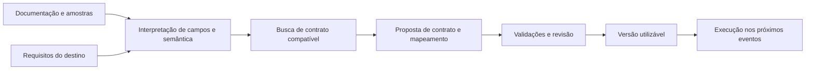
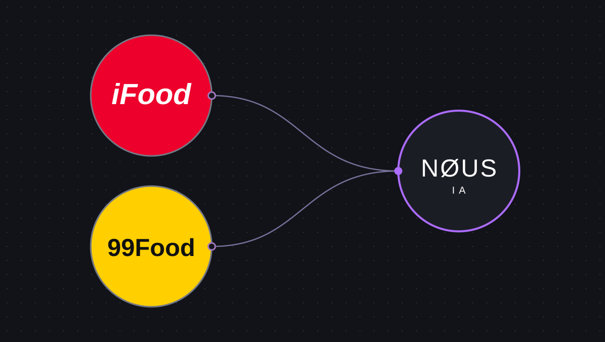
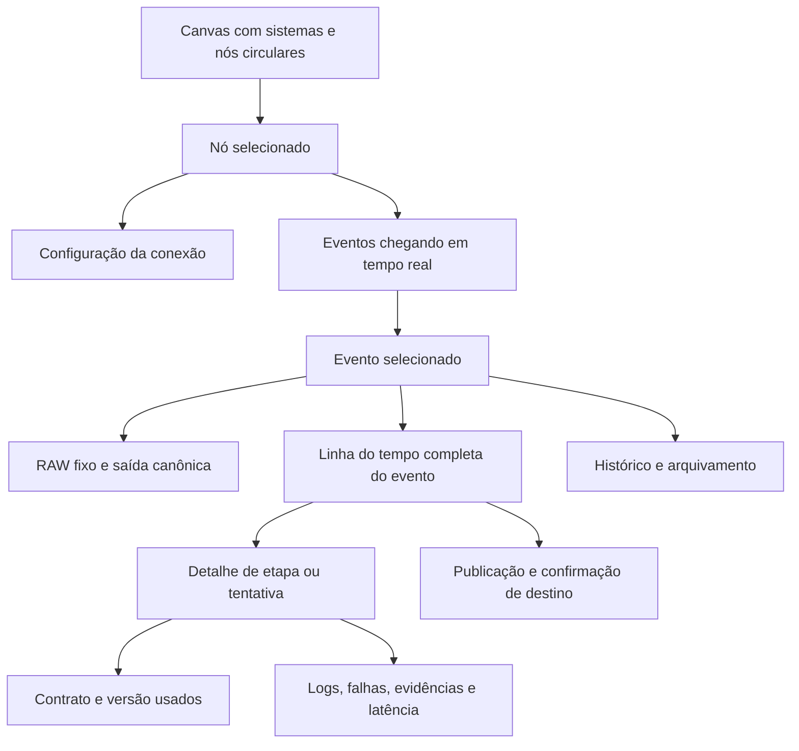

# Especificação detalhada — contratos, normalização e observabilidade

**Data:** 15/11/2026, referência de calendário America/Sao_Paulo.

**Repositório:** `sovive89/nous-ia-contract`.

**Base de código inspecionada:** branch `feat/ifood-99food-simulators`, commit `5ea7f79960a5ac387b3f92e339f45517d5b082c1`.

**Natureza:** documentação de produto, arquitetura proposta e handoff; não é declaração de implementação.

## 1. Nome, origem e limites deste documento

O usuário está definindo uma ferramenta no contexto da NØUS. Ele corrigiu explicitamente a associação entre o título do repositório e o nome do produto e informou que havia uma tabela anterior. Na retomada, leu as associações **NØUS Connect** (ingestão/conectores), **NØUS Semantic Studio** (engenharia semântica), **NØUS Transaction Core** (processamento/distribuição), **NØUS Analytics** e **NØUS Cloud Console**. O [catálogo de nomes recuperado](product-names.md) preserva essas associações e os demais nomes lidos, sem inventar a composição da tabela original inteira.

A associação explícita para engenharia semântica é **NØUS Semantic Studio**. O posicionamento exato de cada motor interno, as alternativas comerciais hesitantes e o nome do componente de edição do canvas continuam a definir. Não transformar toda a lista de nomes em produtos independentes, sinônimos ou módulos já implementados.

O README utiliza o título `NØUS IA — Contract Intelligence`, e a API utiliza `NØUS IA Contract Intelligence`. Esses são identificadores verificados dos artefatos atuais, não prova do nome comercial pretendido.

**Critério de naming recuperado em esclarecimento posterior do usuário:** a ferramenta foi discutida tendo o **AWS Entity Resolution como referência**, mas o nome próprio **não deve conter “Entity” nem “Resolution”**, para não parecer uma reprodução do nome da AWS. A referência ao produto AWS não implica equivalência técnica de escopo, contratação do serviço ou decisão de implementar matching idêntico ao dele.

Este documento reúne a conversa disponível, o código e a documentação versionada examinados. Não afirma reconstruir conversas anteriores não disponíveis ou a origem completa da empresa/produto. A evolução e as correções do usuário estão registradas em [session-decisions-2026-11-15.md](session-decisions-2026-11-15.md).

### 1.1 Como ler o estado das afirmações

- **Implementado:** consta do código inspecionado; o alcance exato é descrito.
- **Verificado em execução:** possui evidência reproduzível no relatório de validação.
- **Relatado:** o usuário informou o resultado no Windows; não houve execução remota naquele computador por esta sessão.
- **Requisito:** comportamento solicitado pelo usuário para o produto.
- **Proposta:** desenho técnico para satisfazer requisitos; ainda sujeito à implementação e às decisões pendentes.
- **Pendente:** falta confirmação, documentação, definição técnica ou execução.

## 2. Ideia central e problema a resolver

Sistemas diferentes representam informações semelhantes de maneiras diferentes. Um sistema pode fornecer um identificador como `orderId`; outro, como `order_id`. A diferença não se limita à escrita: unidades, obrigatoriedade, significado dos estados, estruturas aninhadas e regras de negócio também podem divergir.

A ferramenta pretendida deve interpretar e/ou permitir configurar essas correspondências, representar o resultado em um **contrato JSON** e executar transformações verificáveis. Dentro do ecossistema, os dados convergem para estruturas canônicas versionadas e rastreáveis. O motor deve ser abrangente em domínios, sem assumir que existe um único schema universal para qualquer informação.

O usuário quer visualizar tanto a chegada dos dados e o processamento quanto, quando aplicável, o processo de geração do contrato. Ele enfatizou que preencher campos de um formato escrito previamente no script não demonstra uma IA aprendendo uma integração.

### 2.1 Objetivos

1. Receber dados de uma fonte identificada e preservar a entrada original.
2. Entender ou configurar campos, tipos, unidades, entidades e regras.
3. Criar ou reutilizar um contrato e um modelo canônico compatíveis.
4. Executar as correspondências e validar a transformação.
5. Mostrar entradas, saídas, contratos, evidências, falhas e tempos de processamento.
6. Relacionar qualquer artefato à linha do tempo completa do evento.
7. Encaminhar resultados validados ao destino configurado, incluindo eventual Event Bus.
8. Funcionar com o mesmo motor de contratos fora e dentro do ecossistema.

### 2.2 O que não pode ser apresentado como pronto

O simulador não comprova inferência semântica por IA, geração automática de contratos, integração oficial com marketplace, persistência durável, isolamento de tenant, publicação em barramento ou gravação no ERP. Um JSON Schema presente no repositório não comprova que um endpoint o aplica. Um mockup não comprova que a interface está implementada.

## 3. Glossário e distinções obrigatórias

| Termo | Significado neste projeto | Observação |
| --- | --- | --- |
| RAW / raw data | Entrada original recebida, preservada com sua proveniência | Estruturas de armazenamento ainda propostas |
| Modelo canônico | Estrutura comum com campos, tipos, unidades e significado de domínio | Pode ser descrito em JSON Schema com metadados semânticos adicionais |
| Contrato de conversão | Regras que relacionam entrada e destino, transformações, validações e versões | Pode incluir ou referenciar schemas de origem e destino |
| Mapeamento | Correspondência concreta de campos, valores e unidades | Semelhança de nome não comprova equivalência |
| Evento canônico | Instância de dados produzida segundo um contrato | Não é a definição do modelo nem a prova de geração do contrato |
| `event_type` | Tipo do acontecimento | No simulador é a constante `order.status_changed` |
| `source_status` | Estado exatamente recebido da origem | Preservado no simulador; equivalência de estados não é inferida |
| Status do pedido | Estado de negócio do pedido | Distinto de status de processamento e de contrato |
| Status do processamento | Situação de recebimento, transformação, validação, envio etc. | Um cancelamento de negócio pode ser processado com sucesso |
| Status do contrato | Estado de elaboração/validação/ativação da configuração | Vocabulário exato ainda pendente |
| Node / nó | Representação de um sistema/conexão no canvas | Não significa runtime Node.js |
| Event Bus | Barramento que distribui eventos aos consumidores | Publicação e conclusão no destino são confirmações distintas |
| Entity resolution | Identificação de registros que representam a mesma entidade | Distinta de normalização, geração de contrato e idempotência |
| LLM | Modelo de linguagem usado como possível mecanismo de interpretação/proposta | Provedor/modelo/versão não escolhidos nesta sessão |
| RAG | Recuperação de documentação e evidências para apoiar a interpretação | Não está implementado no código atual |
| Determinístico | Segue regras explicitamente programadas para transformar uma entrada | Python é a linguagem, não sinônimo desse modo de operação |

## 4. Mesma ferramenta, duas formas de uso

O usuário corrigiu a interpretação de que seriam dois produtos ou dois motores. A implementação deve compartilhar o motor de execução e o formato de contrato.

### 4.1 Função personalizada/manual

**Requisito confirmado na conversa:**

1. A pessoa fornece um JSON de uma fonte/output.
2. A ferramenta transforma a visualização desse JSON em uma tabela de campos.
3. Há uma tabela de destino inicialmente vazia.
4. A pessoa preenche a estrutura desejada e as correspondências.
5. Cada edição é salva automaticamente.
6. A configuração gera/atualiza o modelo e o contrato JSON da pessoa.
7. A execução segue o que ela configurou e mostra resultados ou erros.

Nesse modo a pessoa escolhe dispensar a interpretação/revisão assistidas. Não adicionar uma aprovação humana extra obrigatória a cada edição manual, nem exigir exportação como condição para salvar. Exportar pode ser uma função adicional, não a ação principal confirmada.

**Propostas de comportamento:**

- Preservar rascunhos incompletos no autosave; salvar uma edição não significa que ela seja executável.
- Exibir campos ausentes, tipos incompatíveis e falhas de transformação, sem corrigir silenciosamente as escolhas.
- Distinguir a revisão editável atual de uma versão efetivamente utilizada numa execução, para que alterações posteriores não reescrevam o histórico.
- Definir como campos aninhados, arrays, null, ausências e tipos são mostrados em tabela. Essa interação ainda não foi especificada em detalhe.

### 4.2 Uso dentro do ecossistema NØUS

O mesmo motor passa a operar com os contratos, versões e políticas do ecossistema. O usuário não deve alterar inadvertidamente o modelo compartilhado ou a estrutura física do banco por preencher um formulário.

**Proposta:** mudanças constituem revisões; a ativação integrada verifica compatibilidade, testes e revisão necessária. O agente pode auxiliar, mas não deve ser apresentado como garantia de correção semântica. Os critérios exatos para ativação automática, revisão humana e permissões de edição permanecem pendentes.

O cliente não precisa projetar o banco de dados canônico. Contrato lógico e armazenamento físico têm responsabilidades distintas. Um contrato JSON pode ser armazenado em uma coluna apropriada de um banco relacional junto de metadados, sem converter o banco inteiro para um banco documental.

## 5. Artefatos do contrato

### 5.1 Conteúdo pretendido

Um contrato deve descrever ou referenciar:

- Identidade, versão e estado da configuração.
- Origem, operação e domínio a que se aplica.
- Schema da entrada e schema canônico/de destino.
- Caminhos dos campos de entrada e saída.
- Conversões e condições de aplicação.
- Tipos, obrigatoriedade, unidades, vocabulários e validações de domínio.
- Documentos/evidências consultados e decisões de revisão.
- Compatibilidade com versões anteriores e resultados de testes.

Esse é um **formato proposto**. O repositório ainda não contém um schema completo e executável para esse documento de contrato. Não inventar um DSL como se já fosse suportado pelo runtime.

### 5.2 Modelo e contrato podem ser gerados juntos

A geração pode produzir um pacote com a estrutura canônica e os mapeamentos necessários. Se um modelo compatível já existe, a proposta deve poder reutilizá-lo. O contrato de conversão referencia ou inclui o destino; não se transforma automaticamente em um modelo por simples renomeação.

Dois contratos de entrada podem produzir instâncias da mesma estrutura canônica. Fontes diferentes não precisam gerar um novo modelo incompatível por requisição.

### 5.3 Assistência de IA — fluxo pretendido

Documentação tem precedência como evidência do contrato oficial. Amostras ajudam a verificar hipóteses e observar formatos; uma amostra não prova todas as regras, enums, unidades ou estados possíveis. Sem documentação, registrar inferências, ambiguidades e lacunas. Não tratar uma suposição sobre reais/centavos ou estados de pedido como fato.

O processo dos agentes precisa ficar consultável por versão de contrato. Não desaparecer depois da primeira geração. Mudanças incompatíveis na fonte/destino podem exigir nova análise e nova versão. O acionamento exato dessa detecção ainda será definido.

### 5.4 Nome, provedor e escopo dos agentes

O README/blueprint existentes citam **Jev**, **OpenAI RAG**, **Python ML**, **Mem0** e **agente auditor**. Na voz surgiram transcrições como JEV/REG; isso não autoriza reinterpretar Jev como um LLM genérico sem confirmar. A referência à API de Jev continua oficialmente não verificada no projeto.

O usuário também pediu um **agente revisor**. A relação desse nome com o agente auditor do roadmap precisa ser definida: um único papel com nomes alternativos ou dois papéis distintos. A proposta existente restringe o auditor a emitir parecer, sem publicar contratos. Isso permanece uma proposta, não um agente instalado.

## 6. Interface: canvas, nós e níveis de navegação

### 6.1 Direção visual confirmada

O usuário pediu um **mockup visual**, corrigindo o avanço prematuro para implementar um dashboard completo. O escopo visual mais recente foi: **somente nós redondos com as logos dos sistemas no canvas**.

Foi produzida na conversa uma imagem conceitual com iFood e 99Food ligados a um hub NØUS IA, sobre um canvas escuro. Não há frontend correspondente no checkout. Os wordmarks do mockup são representações visuais; não foi fornecido um pacote oficial de marca NØUS ou de assets do produto.

Uma representação vetorial do conceito foi incluída para continuidade visual; não é exportação pixel a pixel da imagem gerada nem aplicação funcional:

Ao clicar em um nó, deve ser possível acessar a configuração de conexão. O canvas inicial não precisa mostrar código RAW, histórico, métricas e todos os formulários ao mesmo tempo. Esses requisitos pertencem aos níveis seguintes de interação.

### 6.2 Mapa de navegação proposto a partir dos pedidos do usuário

Esses são níveis lógicos de navegação. Não significam necessariamente páginas independentes. Painéis e etapas expansíveis podem manter o contexto do evento e evitar uma sequência de telas enterradas.

### 6.3 Nó e configuração de conexão

**Requisito:** clicar no nó dá acesso à configuração daquela conexão. Campos concretos dependem do conector e de sua documentação. Não inventar credenciais, scopes, endpoints ou indicadores de conexão operacional a partir de um logo.

**Proposta:** estado desconectado/configurado/testado deve refletir verificação real. Separar configuração editada da conexão efetivamente verificada. A escolha entre painel lateral, drawer ou outra apresentação ainda não foi decidida.

### 6.4 Eventos chegando em tempo real

Exibir o contexto da origem, pedido/entidade relacionado, horário e estado de processamento. Permitir distinguir eventos recebidos, em processamento, concluídos e com falha segundo um vocabulário técnico ainda a definir.

A demonstração pretendida inclui **duas fontes heterogêneas chegando e convergindo para uma estrutura comum**, e não só um formulário Swagger de uma entrada isolada. Se houver animação ou feed de fixtures, identificar explicitamente como dados fictícios. Não apresentar números de latência, conectividade ou publicação simulados como telemetria real.

### 6.5 RAW fixo e detalhe do evento

O usuário solicitou manter o RAW visível enquanto navega no evento. A entrada original não deve ser substituída pela representação normalizada. O detalhe deve permitir consultar:

- Entrada original e contexto de recebimento.
- Resultado canônico ou resultado parcial claramente identificado.
- Contrato e versão efetivamente utilizados.
- Status de negócio e status de processamento separadamente.
- Linha do tempo, tentativas, erros e durações.
- Resultado da publicação e confirmação do destino quando disponíveis.

### 6.6 Clique em qualquer artefato abre o mesmo acompanhamento

**Requisito central:** clicar no RAW, no payload com falha, no resultado ou em uma etapa abre o workflow isolado daquele evento, preservando todo o histórico anterior e posterior e focando o ponto selecionado.

Não depender de juntar logs por aproximação de timestamp ou pelo nome do pedido. O backend deve produzir relações explícitas durante o processamento.

Uma rota como `/events/{tracking_id}?step={step_id}&attempt={attempt_id}` é apenas um **exemplo de navegação proposta**; não existe na API atual. O formato final e a estratégia de links diretos ainda serão definidos.

### 6.7 Erros e diagnóstico

Um erro deve referenciar a etapa, a tentativa, o contrato aplicado e a evidência disponível: campo/caminho, regra, código e mensagem. A UI deve abrir esse detalhe sem perder o evento selecionado.

O diagnóstico automático precisa distinguir a etapa onde o erro foi observado da causa comprovada. Se a causa não for conhecida, declarar essa incerteza. O agente revisor não deve inventar uma explicação causal. Preservar falhas anteriores mesmo quando uma tentativa posterior tem sucesso.

## 7. RAW, eventos, identidade e histórico

### 7.1 Banco relacional e documentos JSON

Vários documentos JSON podem ocupar linhas distintas de uma tabela. Isso não exige criar um arquivo físico por evento. A consulta de histórico pode retornar um único JSON com uma lista desses registros.

Se a fonte envia snapshots completos, guardar o snapshot recebido. Se envia atualizações parciais/eventos, guardar o conteúdo da atualização. Se envia um histórico acumulado, guardar esse documento como chegou. Não presumir qual desses formatos uma plataforma utiliza sem consultar sua documentação.

### 7.2 Preservação desde a entrada

**Proposta alinhada ao blueprint existente:** atribuir um identificador interno e registrar a entrada antes da validação de negócio, de forma que uma falha de normalização também possua histórico. Definir o tratamento de corpo inválido/não JSON, limites e retenção; esses detalhes não estão implementados.

O RAW preservado mantém o conteúdo de origem. Metadados internos ficam no registro/envelope de armazenamento, sem serem apresentados como campos fornecidos pela plataforma. Quando fidelidade byte a byte for necessária, definir armazenamento do corpo recebido, encoding/content type e hash; uma reserialização JSON não preserva necessariamente os bytes originais.

### 7.3 Identificadores propostos

| Identidade | Finalidade |
| --- | --- |
| Tenant e origem | Delimitar o contexto de integração; body por si só não autentica tenant |
| ID do evento da fonte | Rastrear a mensagem externa, quando existir |
| Identificador interno de acompanhamento | Relacionar todos os artefatos mesmo quando o ID externo falta ou é inválido |
| Referência ao RAW | Consultar a entrada que produziu a execução |
| ID da etapa e dependência | Navegar entre etapas e evidências |
| ID/número da tentativa | Distinguir execuções, retries e reprocessamentos |
| Versão do contrato/mapeamento | Reproduzir a transformação executada |
| Correlation/causation/replay | Relacionar fluxos derivados e replays quando aplicável |

Os nomes físicos, índices e schemas desses identificadores são **pendentes de implementação**. Não confundir o `event_id` externo já usado pelo simulador com um novo identificador interno sem uma decisão de compatibilidade.

### 7.4 Mudança de status e estado atual

Cada atualização recebida pode produzir um novo registro RAW e um novo evento canônico. O estado atual do pedido pode ser uma projeção desses eventos, mantida separadamente. A primeira mensagem não deve ser sobrescrita para simular um histórico.

Campos como `previous_status`/`new_status` foram apresentados como exemplos internos de desenho, não como campos documentados das APIs reais nem como funcionalidade existente. Não derivar o estado anterior apenas da última mensagem recebida sem tratar ordenação, atrasos e concorrência.

Duplicatas, mensagens conflitantes com mesma identidade e eventos fora de ordem exigem políticas explícitas. O blueprint já propõe identidade por tenant/origem/evento e conflitos de hash; não há idempotência durável no runtime atual.

### 7.5 Timestamps e latência

| Informação | Fonte e estado |
| --- | --- |
| `occurred_at` | Existe no simulador; fornecido na entrada sintética, validado com timezone e convertido para UTC |
| `received_at` | Proposto como horário do servidor no recebimento; não existe no endpoint de simulação |
| Início/fim de etapa | Instrumentação proposta para medir duração |
| Horário de publicação/ACK | Proposto; só registrar como confirmado quando houver evidência do barramento/destino |

Manter separados o instante de negócio e os instantes internos. Latência de transporte depende da confiabilidade/sincronização dos relógios da fonte; duração interna deve usar relógio adequado para intervalos. Não preencher tempos fictícios como se fossem medições.

### 7.6 Arquivamento e retenção

O registro começa na entrada; arquivar ao final não é a primeira gravação. O histórico deve incluir êxitos, falhas e tentativas. Definir retenção, acesso, eventual armazenamento frio e reprocessamento antes de prometer conservação definitiva ilimitada. Nenhuma política de prazo foi aprovada nesta conversa.

## 8. Event Bus e processamento de destino

Fluxo proposto, consistente com `event-integration-blueprint.md`:

**Origem → autenticação/contexto → RAW/inbox → contrato versionado → transformação/validação → canônico/outbox → worker → Event Bus → consumidor → efeito no destino.**

O Event Bus distribui eventos. Publicação aceita não equivale à criação de pedido no ERP. A UI deve representar essas confirmações separadamente. A proposta anterior contempla retries limitados, DLQ, replay e reconciliação, sem promessa de exactly-once ponta a ponta.

Não publicar um resultado de revisão como se fosse um contrato ativo. Não transformar replay em repetição de efeitos já aplicados. A escolha de serviço de barramento, infraestrutura e mecanismo de atualização da UI continua aberta.

## 9. ERP relacional sem API e contexto de integração

O usuário esclareceu que seu ERP usa banco relacional e não expõe API atualmente. Para especificar o destino, o material necessário pode ser o DDL, migrations, modelos e a lógica existente de criação/atualização de pedidos. Não é necessário exigir que o banco já exporte JSON.

Uma API pode ser criada na aplicação: recebe uma requisição JSON, executa as regras do ERP e persiste nas tabelas. O formato JSON de comunicação não define o modelo físico do banco. Reutilizar regras de preços, itens, estoque, pagamentos e transações conforme o ERP realmente as implementa.

Uma rota como `POST /integracoes/pedidos` é um exemplo de desenho, não uma rota já criada. O runtime/stack/banco do ERP e o código do fluxo de pedidos ainda não foram examinados. O nome “Popnova” apareceu na fala do usuário; grafia, repositório e relação exata com o produto precisam de confirmação.

Na integração direta de um ERP com iFood, a adaptação ao formato interno é implementada pelo lado do ERP ou por uma integradora responsável. A responsabilidade concreta depende da integração contratada; não atribuir um conector a um fornecedor específico sem identificar o produto.

### 9.1 API Gateway

AWS API Gateway pode ser a porta de entrada que encaminha requisições para um backend HTTP, uma função Lambda ou outros serviços. Ele não elimina a necessidade de implementar as operações e regras de negócio do ERP. Gateway não é requisito para testar uma API local FastAPI.

Nenhum API Gateway, Lambda, recurso AWS ou endpoint de ERP foi criado nesta sessão. A restrição de não fazer deploy permanece.

## 10. Tecnologias e catálogo de módulos

| Módulo/capacidade | Nome verificado ou designação de trabalho | Tecnologia/artefato | Estado |
| --- | --- | --- | --- |
| Aplicação HTTP | Título atual: NØUS IA Contract Intelligence | FastAPI, Pydantic; `app/main.py` | Implementada |
| Avaliação de correspondência | `/v1/contracts/evaluate` | Tipos/unidades + `difflib.SequenceMatcher` | Heurística; não é IA semântica |
| Validação estrutural | `/v1/contracts/validate` | `jsonschema.Draft202012Validator` | Implementada, com limites descritos no relatório |
| Simuladores | `/v1/simulators/normalize` | Python, Decimal, datetime; `app/simulators.py` | Implementados em memória |
| Contrato de evento | `event-envelope.schema.json` | JSON Schema Draft 2020-12 | Arquivo existente; integração runtime não presumida |
| Pedido canônico fictício | `nous.delivery.order.v1` | `schemas/nous.delivery.order.v1.json` | Schema proposto; não aplicado pelo simulador |
| Evento parcial do simulador | `nous.order-status.v1` | Referência textual no código | Não há arquivo correspondente nesta revisão |
| Editor manual/personalizado | Capacidade de engenharia semântica; nome da área recuperado: NØUS Semantic Studio | JSON → tabela → destino editável → contrato, autosave | Requisito, não implementado; organização interna a definir |
| Registro de contratos | Designação funcional, não marca oficial | IDs, versões, estados, evidências | Proposto |
| Motor de geração | Nome definitivo pendente | Interpretação, schemas, mapeamentos e validação | Proposto |
| Jev | Nome citado no README/blueprint | API/adaptador a verificar oficialmente | `not_configured` |
| OpenAI RAG | Nome citado no README/blueprint | Recuperação de documentação + modelo a escolher | `not_configured` |
| Python ML | Nome citado no README/blueprint | Modelo treinável e dataset rotulado | `not_trained`; distinto dos scripts Python atuais |
| Mem0 | Nome citado no README/blueprint | Memória de decisões autorizadas | `not_configured` |
| Agente auditor | Nome citado no README/blueprint | Parecer estruturado, proposta de acesso somente leitura | `not_configured` |
| Agente revisor | Nome usado pelo usuário | Papel/limites a consolidar com auditor | Solicitado, não implementado |
| Policy Engine | Nome usado no blueprint | Ativação, revisão e decisões | Proposto |
| Canvas e nós | Nome do componente, não framework | Frontend/renderer ainda não escolhido | Mockup conceitual gerado; sem frontend |
| RAW data layer | Nome funcional usado pelo usuário | Recebimento, persistência, proveniência | Proposto |
| Linha do tempo e logs | Designação funcional | Correlação de evento/etapas/tentativas | Proposta |
| Inbox/outbox e worker | Blueprint existente | Transações, reentrega e reconciliação | Propostos |
| Banco | PostgreSQL + pgvector no roadmap | Persistência relacional e possível busca vetorial | Não instalado/integrado no projeto |
| Autenticação multi-tenant | Roadmap existente | Provedor e autorização a definir | Não implementada |
| Barramento e consumidores | Event Bus | Serviço e conectores a definir | Não implementados |
| API do ERP | Nome do ERP/stack a confirmar | Regras da aplicação e banco relacional existente | Não implementada/examinada |
| Execução e testes | Uvicorn, pytest, HTTPX | `requirements.txt`, `tests/` | Existentes |
| Empacotamento | Dockerfile | Docker | Arquivo existente; presença não comprova build nesta sessão |

Não definir React, Next.js, Vue, Canvas2D, SVG, WebSocket/SSE ou outro stack de UI como escolha aprovada: foram consideradas alternativas de implementação, mas não há decisão confirmada nem frontend criado nesta revisão.

## 11. Estado real do código inspecionado

### 11.1 Endpoints existentes

- `GET /health`: resposta de saúde e versão.
- `POST /v1/contracts/evaluate`: compatibilidade de tipos/unidades e similaridade nominal; retorna REVIEW/REJECT e revisão humana obrigatória.
- `POST /v1/contracts/validate`: valida um payload com um schema fornecido.
- `POST /v1/simulators/normalize`: adapta dois formatos sintéticos fixos e retorna um evento parcial.

### 11.2 Mapeamentos efetivos dos simuladores

| Dado | iFood sintético | 99Food sintético | Resultado |
| --- | --- | --- | --- |
| Pedido | `payload.orderId` | `payload.order_id` | `subject.external_id` e `payload.order_id` |
| Evento | `payload.eventId` | `payload.event_id` | `event_id` |
| Estado da fonte | `payload.code` | `payload.status` | `payload.source_status`, sem inferência de equivalência |
| Valor em unidades principais | `payload.total` | `payload.amount` | `payload.total_minor` em centavos |
| Moeda | `payload.currency`, BRL por padrão | Mesmo comportamento | Só aceita BRL |
| Instante | `payload.occurred_at` | Mesmo campo | UTC com sufixo Z |

Constantes: `event_type=order.status_changed`, `schema_ref=nous.order-status.v1`, `simulation=true`. Resposta: `requires_human_review=true`, `persisted=false`, `published=false`.

Entradas monetárias aceitas são string decimal ou inteiro em unidades principais. Booleanos/floats, valores negativos, não finitos e mais de duas casas decimais são rejeitados pelo código. IDs/status precisam ser strings não vazias. A existência de `schema_ref` não resolve ou registra o contrato automaticamente.

### 11.3 Lacunas materiais

Não há geração de contrato por IA; persistência RAW; banco; registro operacional de versões; runtime de contrato dinâmico; autenticação; idempotência durável; API de ERP; publicação; interface; timeline de processamento; agente revisor/auditor ativo; integração Jev/RAG/ML/Mem0.

Os documentos anteriores e schemas são úteis como proposta, mas não substituem essas implementações. A evidência executável e os limites do teste estão em [validation-2026-11-15.md](validation-2026-11-15.md).

## 12. Demonstração desejada e critérios de aceite

### 12.1 Visual e navegação

- Canvas inicial com nós circulares e logos dos sistemas.
- Seleção de nó dá acesso à conexão e ao fluxo de eventos daquela origem.
- Duas fontes de demonstração identificadas como fictícias; nenhuma chamada oficial necessária.
- Seleção de evento preserva RAW visível e abre seu acompanhamento completo.
- Clique em etapa/RAW/erro/resultado mantém o mesmo evento e foca o item correto.
- Contrato e versão usados são acessíveis no contexto da execução.
- Há distinção entre estado de negócio, processamento, contrato e entrega.
- Interface de erro apresenta evidência e não inventa causa.
- Operação por teclado, leitura adequada e contexto/foco preservados precisam integrar a implementação; ainda não foram testados.

### 12.2 Função personalizada

- JSON aparece como tabela de campos; destino começa vazio.
- Usuário define campos, tipos, correspondências e conversões.
- Autosave preserva mudanças e rascunhos incompletos.
- Contrato JSON e modelo refletem a configuração efetivamente salva.
- Execução mostra erros sem substituir escolhas silenciosamente.
- O mesmo motor/formato de contrato atende a operação isolada e integrada.

### 12.3 Assistência e contrato

- Evidências documentais rastreáveis para propostas semânticas.
- Separar valores observados, inferências e regras oficialmente documentadas.
- Dúvidas e incompatibilidades são representadas explicitamente.
- Mostrar contrato gerado/reutilizado e o registro da revisão.
- Executar a transformação a partir da versão aprovada/utilizável, em vez de simular uma IA que só aplica o `if source` atual.
- Medir qualidade com exemplos e conjunto de avaliação, sem anunciar acurácia não medida.

### 12.4 Persistência e entrega

- RAW preservado desde a entrada e relacionado aos resultados.
- Etapas e tentativas possuem tempos e referências, incluindo eventos que falham cedo.
- Replay não destrói histórico e não repete efeitos de negócio já aplicados.
- Duplicidade, conflito, concorrência e eventos fora de ordem são testados.
- Publicação, consumo e efeito no destino têm confirmações distintas.
- Retenção/arquivamento seguem uma política explícita.

## 13. Sequência sugerida de implementação

Esta sequência é uma proposta de recortes; não é estimativa de prazo nem confirmação de execução:

1. Usar o catálogo de nomes recuperado, definir os limites dos componentes e identificar o destino ERP; manter distinção de fatos/propostas neste handoff.
2. Aprovar visual de nós circulares e a navegação até o detalhe, sem expandir o canvas inicial além do pedido atual.
3. Construir UI com fixtures identificadas e rotas internas de evento/etapa; testar links, foco e RAW fixo.
4. Implementar armazenamento RAW, tracking, etapas/tentativas e atualização real da timeline.
5. Definir schema do contrato e runtime das transformações; construir editor personalizado com autosave.
6. Implementar versões, políticas do ecossistema e referências de execução.
7. Integrar recuperação documental, modelo de interpretação e revisão, com provedores efetivamente escolhidos e evidências.
8. Integrar outbox/barramento/consumidor e o ERP em ambiente de teste, com regras e contratos documentados.

O escopo não permite prometer a conclusão do produto inteiro no mesmo dia. A documentação e a prova sintética têm alcance distinto de um produto integrado com IA.

## 14. Decisões pendentes e perguntas de continuidade

1. Como os componentes internos lidos se organizam no NØUS Semantic Studio e nos demais produtos? Usar as associações explícitas do catálogo, preservando os nomes ainda hesitantes e a restrição de não usar “Entity”/“Resolution” no nome próprio.
2. Qual é a grafia/repositório do ERP mencionado como Popnova? Qual stack/banco/fluxo de pedidos ele usa?
3. Qual produto/API é Jev, e qual documentação oficial deve orientar o adaptador?
4. Agente revisor e auditor serão o mesmo módulo ou papéis separados?
5. Qual provedor, modelo e versão executarão a interpretação? Onde e com que configuração autorizada?
6. Qual repositório/corpus e política de versões sustentarão RAG? Como verificar atualidade e referências?
7. Qual é o formato executável do contrato e o conjunto permitido de transformações?
8. Como separar autosave de rascunho, revisão utilizável e ativação integrada?
9. Quais validações semânticas e estados de negócio serão aprovados por domínio?
10. Quais contratos oficiais de iFood e 99Food e respectivas versões serão utilizados? O simulador não responde a isso.
11. Onde persistir RAW, contratos e eventos, com quais políticas de acesso e retenção?
12. Qual mecanismo atualizará eventos em tempo real na UI?
13. Qual barramento/destino, estratégia de confirmação e política de retries serão adotados?
14. Quais ações de conexão e operação serão permitidas ao usuário em cada contexto?

## 15. Fontes e limites de pesquisa

- Código e documentos locais nas versões identificadas no início deste arquivo.
- [AWS Entity Resolution: descrição oficial](https://docs.aws.amazon.com/entityresolution/latest/userguide/what-is-service.html): serviço de matching/linking com schema mapping configurado; não usar sua descrição como prova de geração autônoma de contratos arbitrários.
- [iFood: detalhes de pedido](https://developer.ifood.com.br/en-US/docs/food/guides/modules/order/details): referência oficial consultada para explicar a existência do formato da API; não constitui implementação do contrato completo no simulador.
- [iFood: guia de implementação de pedidos](https://developer.ifood.com.br/en-US/docs/food/guides/modules/order/workflow): contexto de consumo de eventos e consulta de detalhes. Não houve chamada à Merchant API.
- [AWS API Gateway: descrição oficial](https://docs.aws.amazon.com/apigateway/latest/developerguide/welcome.html): porta de entrada/integrador de backend; não implementa automaticamente as regras do ERP.

Consulta dessas páginas em 15/11/2026. A documentação oficial de 99Food não foi examinada nesta sessão. Não houve verificação documental de Jev ou de um ERP específico.

O blueprint anterior referencia uma skill `aws-event-integration-lab-blueprint(1).skill`. O pacote original não está neste checkout; esta sessão examinou o documento derivado, não revalidou o pacote original.

## 16. Restrições de execução e publicação

- Não fazer deploy ou provisionar AWS.
- Não modificar a branch `main`.
- Não apagar arquivos nem descartar alterações locais do Windows.
- Não expor credenciais, chaves privadas ou conteúdo de `.env`.
- Não usar APIs reais de iFood/99Food nos testes sintéticos.
- Não anunciar IA funcionando quando só há regras determinísticas.
- Não configurar pull automático.
- Trabalhar em branch de documentação separada; publicação do handoff não significa merge ou implementação.
